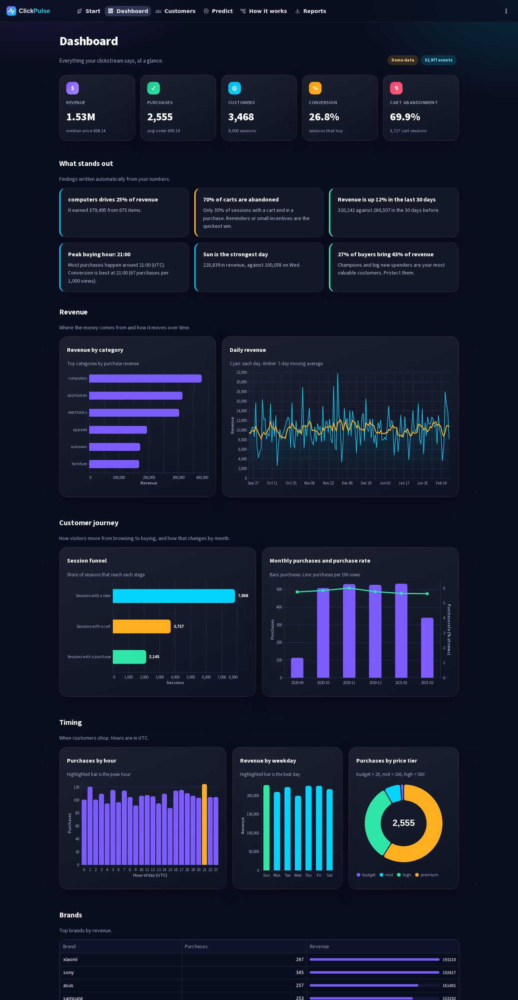
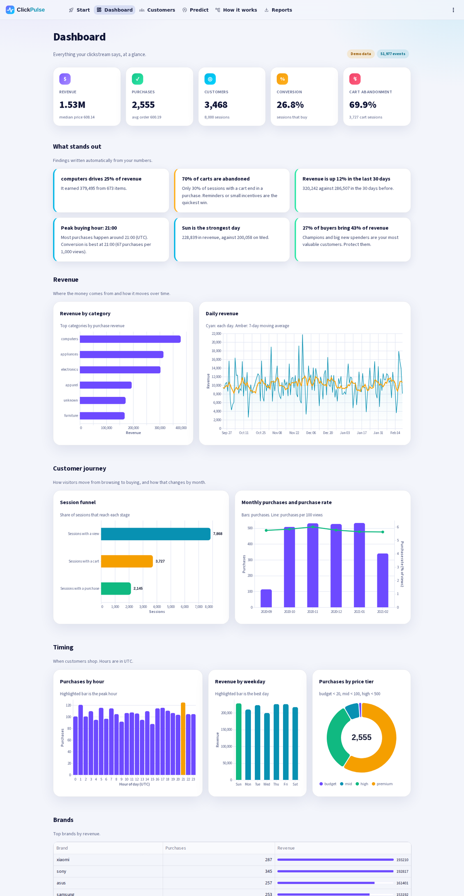
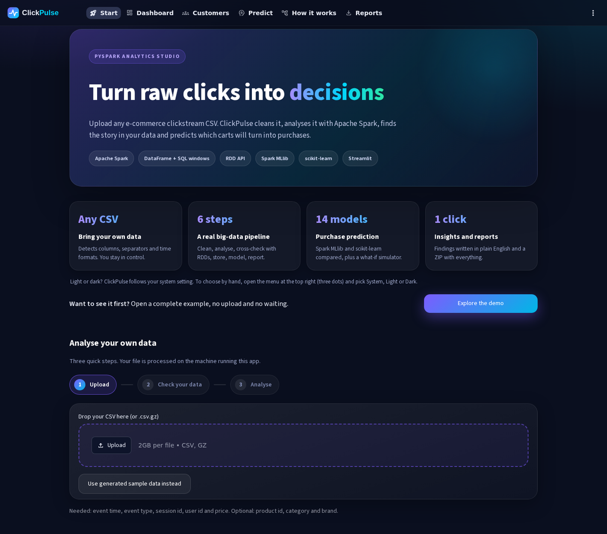
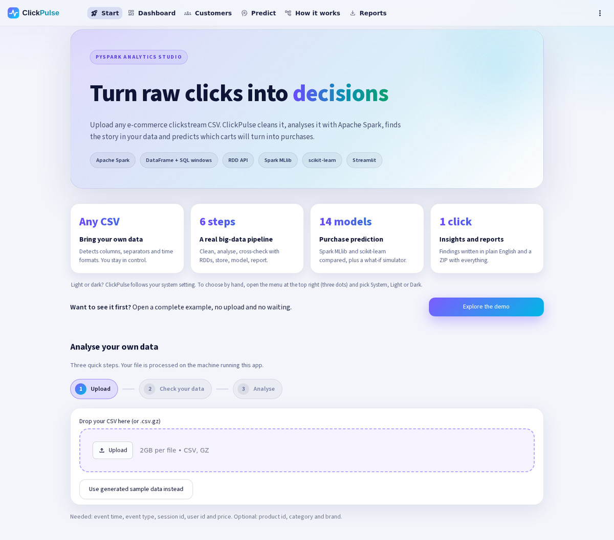
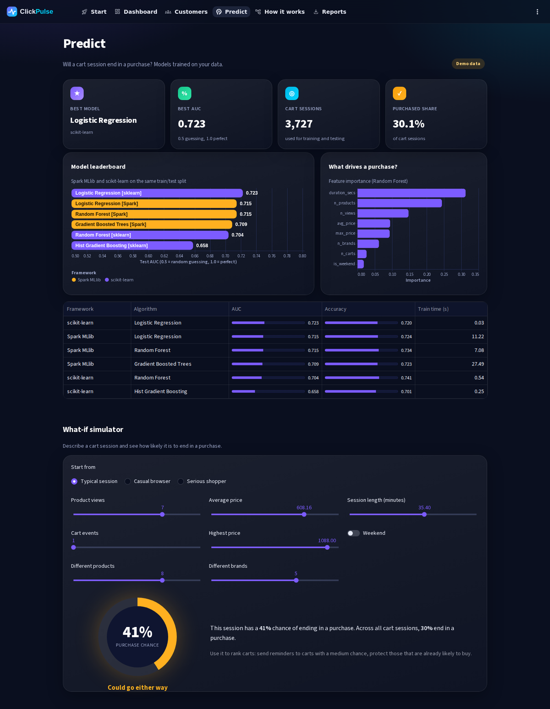
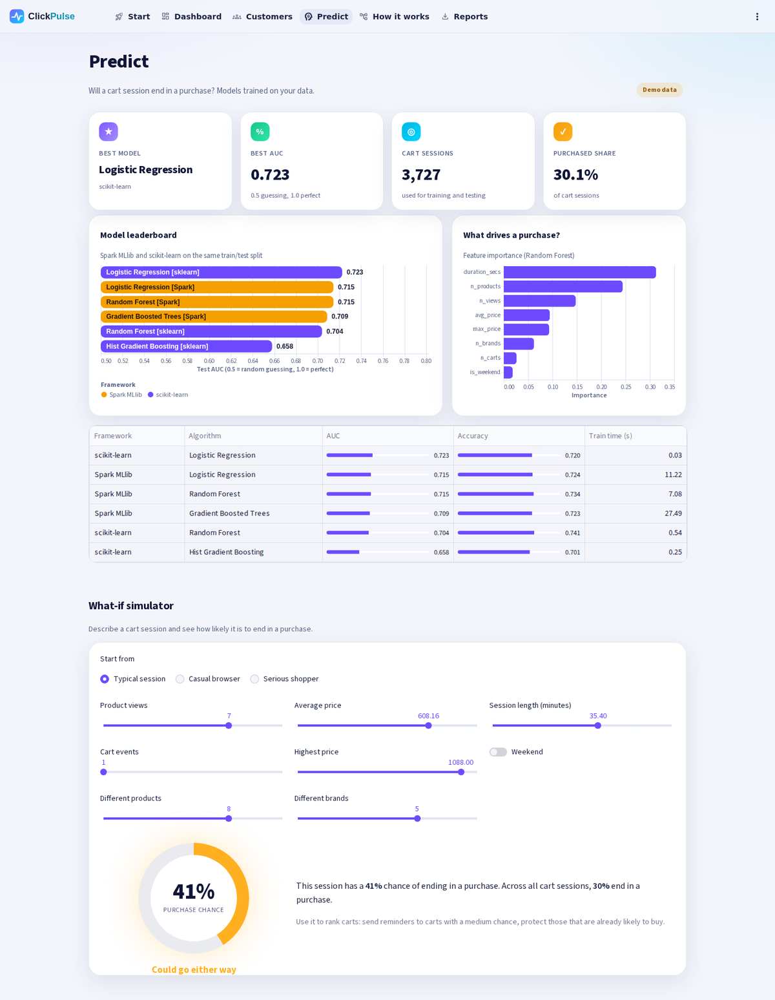
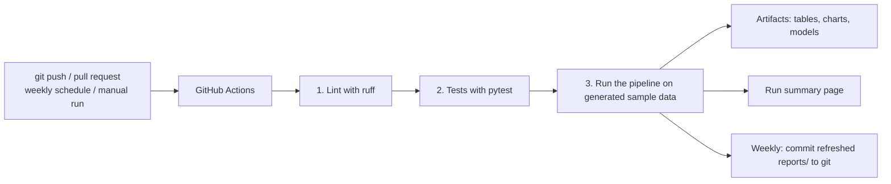

# ClickPulse: e-commerce clickstream analytics (PySpark + Streamlit + Git automation)

Upload **your own** clickstream CSV (customer views, add-to-cart events and purchases) and ClickPulse cleans it, analyses it with Apache Spark, writes the key findings in plain English, draws interactive dashboards, segments your customers and predicts which carts will turn into purchases, **for your data**. A GitHub Actions workflow tests and runs the whole pipeline automatically on every push.

**Dark and light themes.** ClickPulse follows your system setting. To choose by hand, open the menu at the top right (three dots) and pick **System**, **Light** or **Dark**. The whole app switches instantly, including the charts and the logo.

| Dark | Light |
|---|---|
|  |  |
|  |  |
|  |  |

## 1. Quick start: install and run in 3 steps

You need only two things on your computer: **Python 3.10 or newer** and **Java 17 or newer** (Spark runs on Java). Everything else (PySpark, pandas, scikit-learn, matplotlib, Streamlit ...) is installed **automatically** by the launcher the first time you run it. The packages go into a private folder `.venv` inside the project, so nothing else on your computer is touched.

| Step | Windows | macOS / Linux |
|---|---|---|
| 1. Open a terminal in the project folder | `cd path\to\ecommerce-clickstream-pipeline` | `cd path/to/ecommerce-clickstream-pipeline` |
| 2. Start the app (first run installs everything, a few minutes) | `python run.py` (or `run.bat`) | `python3 run.py` (or `./run.sh`) |
| 3. Open the address printed in the terminal | http://localhost:8501 | http://localhost:8501 |

Install Java if the launcher says it is missing: Windows `winget install EclipseAdoptium.Temurin.17.JDK`, macOS `brew install --cask temurin@17`, Ubuntu `sudo apt install openjdk-17-jre-headless`, or download from https://adoptium.net/. Run the same command again afterwards.

### Running on Windows (step by step)

1. **Install Python 3.10 or newer** from https://www.python.org/downloads/. On the first installer screen tick **"Add python.exe to PATH"**. (If typing `python` opens the Microsoft Store, the installer was not used or PATH was not ticked. The command `py -3` works either way.)
2. **Install Java 17 or newer.** Open Command Prompt and run `winget install EclipseAdoptium.Temurin.17.JDK`, or download the installer from https://adoptium.net/. Close and reopen the Command Prompt afterwards. Check with `java -version`.
3. **Put the project in a simple folder**, for example `C:\projects\clickstream` (unzip it there). Avoid folders inside **OneDrive** and avoid paths with spaces: both are common causes of Spark errors on Windows.
4. **Open Command Prompt (or PowerShell) in that folder.** In File Explorer, click the address bar, type `cmd` and press Enter.
5. **Start the app:** in **PowerShell** type `.\run.bat` (with the dot and backslash in front, PowerShell requires this); in **Command Prompt** type `run.bat`; both also work as `py -3 run.py`. The first run creates `.venv` and installs all packages (a few minutes, about 1 GB of downloads). Later starts take seconds.
6. If **Windows Defender Firewall** asks about Java or Python, choose **Allow access on private networks**. Spark talks to itself on your computer and needs this.
7. Open http://localhost:8501 (the launcher also tries to open it for you). Press `Ctrl+C` in the window to stop the app.

Other commands on Windows: `run.bat test --quick`, `run.bat test`, `run.bat sample`, `run.bat pipeline --input C:\data\my_events.csv`.

**What works on Windows without extra setup:** reading your CSV, cleaning, all analysis, the RDD cross-check, machine learning, charts, the report and the ZIP download. **One optional extra:** saving the cleaned data as a Parquet file needs Hadoop's Windows helper (`winutils.exe`). Without it, the app shows a yellow warning and simply skips that one file; everything else is unaffected. If you want the Parquet file anyway, install a `winutils` build that matches Hadoop 3.4, put it in `C:\hadoop\bin`, and set the environment variable `HADOOP_HOME=C:\hadoop`, or run the project inside WSL (Windows Subsystem for Linux), where no extra setup is needed.

**Windows-specific problems**

| Problem | Fix |
|---|---|
| `python` is not recognised, or opens the Microsoft Store | Use `py -3 run.py`, or reinstall Python with "Add python.exe to PATH" ticked |
| "Java was not found" although Java is installed | Run `py -3 run.py doctor`. It lists every place it looked for Java and what it found. The launcher checks `PATH`, `JAVA_HOME`, conda environments and the usual install folders (`C:\Program Files\Eclipse Adoptium`, `Java`, `Microsoft`, `Zulu` ...). If your Java is inside a conda environment, activate that environment first. As a last resort set it yourself: `set JAVA_HOME=C:\Program Files\Eclipse Adoptium\jdk-17.0.9.9-hotspot` (use your real folder), then run again |
| Installing Java just now, still "not found" | Close and reopen the terminal so the new PATH is loaded |
| `ReadTimeoutError` / "Read timed out" / very slow download while installing | Slow internet. PySpark is one 450 MB file. Run the same command again (finished downloads are kept and interrupted ones are resumed). Try a phone hotspot, or switch off VPN / proxy for the first install. Still failing: download the PySpark `.tar.gz` file with your browser from https://pypi.org/project/pyspark/#files, create a folder `wheels` in the project folder, put the file there and run again. The launcher uses it automatically |
| "Python worker failed to connect back" | Move the project to a short path without spaces and outside OneDrive, allow the firewall prompt, restart the app |
| Messages like "Exception while deleting Spark temp dir" when the app stops | Harmless Windows file-locking warnings. Ignore them |
| Antivirus slows the first start | Wait, or add the project folder to the antivirus exclusions |
| Garbled characters in the terminal | Only the terminal display. Results are saved as UTF-8 and open correctly in the app |
| Long install fails half way | Run `run.bat` again. It continues, and deleting the `.venv` folder gives a completely fresh start |

### All launcher commands

| Command | What it does |
|---|---|
| `python run.py` or `python run.py app` | Starts the web app and opens your browser |
| `python run.py test --quick` | Fast checks (a few seconds): column detection, error messages, app starts |
| `python run.py test` | Full test suite on generated data (about 3 minutes, because it starts Spark) |
| `python run.py sample` | Creates a fake `data/events.csv` for trying things out |
| `python run.py pipeline --input your_file.csv` | Runs the analysis without the browser |
| `python run.py lint` | Checks the code style |
| `python run.py setup` | Only installs the packages |
| `python run.py doctor` | Shows what was found (Python, Java, ...). Send this output when something does not work |

(On macOS/Linux use `python3` or `./run.sh` instead of `python`; on Windows `run.bat` also works.)

## 2. How to test it locally

Follow these steps in order. Each one proves one more part works.

1. **Install check:** `python run.py setup`. It checks Python and Java, creates `.venv` and installs the packages. It ends with "Setup finished".
2. **Fast tests:** `python run.py test --quick`. Expect `3 passed`.
3. **Try the app with sample data:** `python run.py`, open http://localhost:8501, click **Use sample data instead** in the left sidebar, then **Run analysis**. After about 2 minutes you should see the metrics and the result tabs.
4. **Try the app with your own file:** upload your CSV, check the column guesses, press **Run analysis**.
5. **Full tests (optional, about 3 minutes):** `python run.py test`. Expect every test to pass.
6. **Command line (optional):** `python run.py pipeline --input data/events.csv`, then open `reports/summary.md`.

**If something goes wrong**

| Message or problem | Fix |
|---|---|
| "Java was not found" | Install Java 17 or newer (see above), then run the command again |
| "Python 3.10 or newer is needed" | Install a newer Python from https://www.python.org/downloads/ |
| "Could not create the virtual environment" (Ubuntu/Debian) | `sudo apt install python3-venv` |
| "The packages could not be downloaded" | See the slow-download row in the Windows table above (same fix on every system): run again, change network, or use the `wheels` folder |
| `AttributeError: module 'ui.theme' has no attribute ...` or a message about files from different versions | Old and new files are mixed (a new zip was unzipped over an old folder, or the app was running while files changed). Stop the app (Ctrl+C), unzip the newest zip into a **new empty folder**, delete any `__pycache__` folders and start again |
| Out of memory on a big file | Set `SPARK_DRIVER_MEMORY=8g` (Windows: `set SPARK_DRIVER_MEMORY=8g`, macOS/Linux: `export SPARK_DRIVER_MEMORY=8g`) or use the sidebar option to analyse only the first N rows |
| Port 8501 already in use | `python run.py app --port 8502` |
| Warning about Parquet / `winutils` on Windows | Harmless: only the optional Parquet file is skipped (see "Running on Windows") |
| Start completely fresh | Delete the `.venv` folder and run again |

### The app

| Page | What you get |
|---|---|
| **Start** | Upload your CSV, check the preview and the guessed columns, press **Run analysis** and watch live progress. Or click **Explore the demo** to see a complete example instantly (no upload, no waiting). |
| **Dashboard** | KPI cards, findings written automatically from your numbers ("computers drive 25% of revenue", "70% of carts are abandoned" ...), interactive charts (hover for details): revenue by category, daily revenue with 7-day average, funnel, monthly trend, peak hours, weekdays, price tiers, top brands. |
| **Customers** | RFM segments (Champions, Big new spenders, Regular, At risk / lapsed), how much each is worth and what to do with each. |
| **Predict** | Model leaderboard (Spark MLlib and scikit-learn), what drives a purchase, and a **what-if simulator**: move sliders to describe a cart session and see its purchase chance. |
| **How it works** | The pipeline diagram plus the facts of your run: data quality, which column was used for what, and the RDD cross-check. |
| **Reports** | Download everything as a ZIP (tables, charts, trained models, report), each table as CSV, and read the written report. |

What your file needs:

| Field | Needed? | Example |
|---|---|---|
| Event time | required | `2021-01-05 10:15:00`, `2021-01-05T10:15:00`, `2020-09-24 11:57:06 UTC`, unix seconds or milliseconds |
| Event type | required | `view`, `cart`, `purchase` (or your own words, mapped in step 2) |
| Session id | required | `sess-123` |
| User id | required | `42` or `cust-42` (any text) |
| Price | required | `129.90` |
| Product id, category, brand | optional | missing values are filled with `unknown` |

The app explains clearly when something is wrong (a required column is missing, no value is marked as purchase, all times are unreadable, ...). Very large file? Use the sidebar option to analyse only the first N rows, and set `SPARK_DRIVER_MEMORY` (for example `8g`) before starting the app.

### Command line (same pipeline, no browser)

```bash
python run.py pipeline --input path/to/your_file.csv
python run.py pipeline --input your_file.csv --mapping my_mapping.json --row-limit 500000
```

`my_mapping.json` is optional and only needed when the automatic guess is wrong:

```json
{"columns": {"event_time": "When", "event_type": "Action", "user_session": "Visit",
             "user_id": "Customer", "price": "Amount"},
 "events": {"click": "view", "add_to_basket": "cart", "order": "purchase"}}
```

Results go to `outputs/` (tables, charts, models, Parquet) and `reports/summary.md`.

## 3. The business problem

An online store records every customer click but has not turned it into decisions. The pipeline answers: **where does revenue come from, where do customers drop out, when do they shop, which customers matter most, and will a cart turn into a purchase?** On the original 885,129-event dataset: revenue 5.13 million, computers 72.8% of revenue, 49.7% cart abandonment, best shopping hours 09:00 to 11:00 UTC, top 29% of buyers produce about 61% of revenue, best model AUC 0.67.

## 4. What the pipeline does

1. **Map and clean:** translate your columns to standard ones, parse times, remove duplicates and unusable rows, add date, category and price features.
2. **Analysis:** KPIs, revenue by category and brand, monthly trend (pivot), daily revenue with running total and 7-day average (window functions), funnel and cart abandonment, shopping hours and weekdays, RFM customer segments.
3. **RDD cross-check:** recomputes revenue, brand revenue and customer journeys with the RDD API (`mapPartitions` with an accumulator, `reduceByKey`, `groupByKey`, a broadcast variable).
4. **Storage:** cleaned data as Parquet, partitioned by month.
5. **Machine learning:** predicts whether a cart session ends in a purchase (3 Spark MLlib and 3 scikit-learn models), saves the models as `.pkl`, reloads one to verify.
6. **Charts and report:** PNG charts and `summary.md`.

## 5. Git automation



| Trigger | What happens |
|---|---|
| `git push` or pull request | Lint, tests (including a test on a differently-shaped user file and an app smoke test), then the full pipeline on generated sample data. A red cross on GitHub means something broke. |
| Every Monday 06:00 UTC | Same, then the refreshed `reports/` is **committed back to the repository automatically**. |
| "Run workflow" button | Same, plus an option to also execute the notebook. |

The workflow is [`.github/workflows/pipeline.yml`](.github/workflows/pipeline.yml), with a comment on every step. The real data is never committed (see `.gitignore`); the automation generates fake data with the same columns.

Put it on GitHub (one time): create an **empty** repository, then run `bash scripts/git_setup.sh https://github.com/YOUR-NAME/YOUR-REPO.git` and open the **Actions** tab. Suggested workflow: work on a branch (`git switch -c feature/new-chart`), push, open a pull request, wait for the green check, merge.

## 6. Developer commands

Everything goes through the launcher, which installs the packages for you: `python run.py lint`, `python run.py test`, `python run.py sample`, `python run.py pipeline --input data/events.csv`. The GitHub Actions workflow installs the same packages from `requirements-dev.txt`.

## 7. Project structure

```
.
├── run.py, run.bat, run.sh          launcher: installs packages, then runs app / tests / pipeline
├── app.py                           the web app shell: theme, logo, top navigation
├── ui/
│   ├── theme.py                     light and dark palettes, CSS and components (hero, KPI cards, stepper ...)
│   ├── charts.py                    interactive charts (Altair), colours follow the theme
│   ├── state.py, nav.py             shared state and page links
│   ├── assets/logo.svg
│   └── pages/                       start, dashboard, customers, predict, how_it_works, reports
├── src/
│   ├── mapping.py                   detect and validate which column means what
│   ├── ingest.py                    read any CSV, standardise, clean, features
│   ├── analysis.py                  KPIs, revenue, trend, funnel, hours, RFM
│   ├── insights.py                  plain-English findings written from the numbers
│   ├── rdd_crosscheck.py            RDD API cross-check
│   ├── ml.py                        session dataset, models, .pkl files
│   ├── demo.py                      loads the bundled demo results
│   ├── java_env.py                  finds Java the way Spark does
│   ├── charts.py, report.py, export.py, spark_session.py
│   └── run_pipeline.py              one command that runs everything
├── demo/                            ready-made demo results (JSON and CSV)
├── tests/                           pytest tests (pipeline, custom files, Java, launcher, every app page)
├── scripts/                         generate_sample_data.py, build_demo.py, git_setup.sh
├── docs/screenshots/                images used in this README
├── notebooks/                       the explained step-by-step notebook
├── .github/workflows/pipeline.yml   automation: lint -> test -> run -> publish
├── .streamlit/config.toml           light and dark theme colours, upload size
└── reports/                         generated report and charts
```

## Notes

- `spark.sql.ansi.enabled` is switched off so a division by zero returns NULL instead of stopping the job.
- Event labels that are not mapped to view, cart or purchase are ignored and counted in the data-quality section.