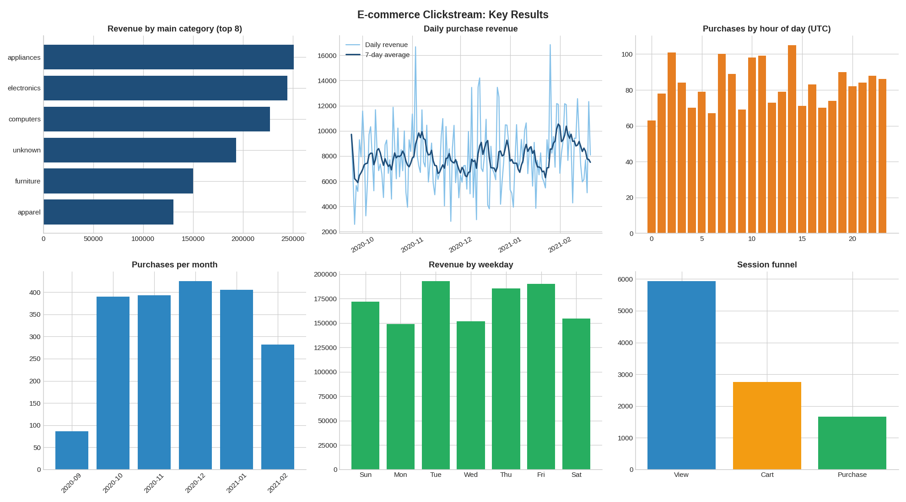
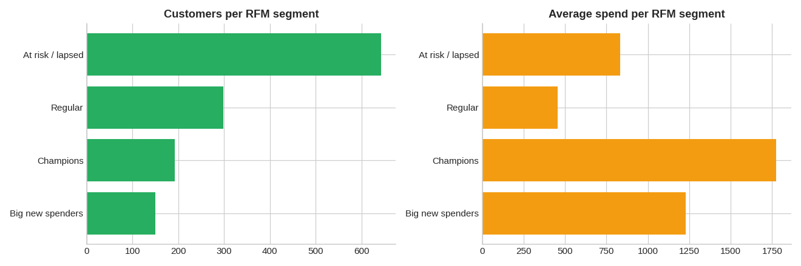
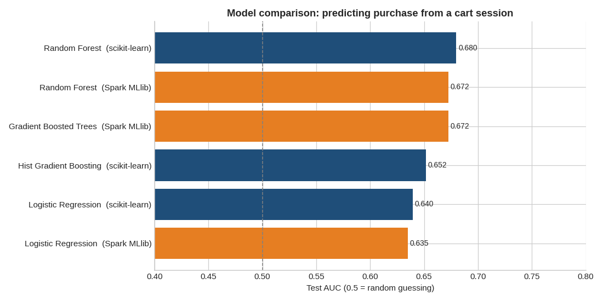

# Pipeline summary

Generated: 2026-11-04 23:45 UTC  |  input: `data/events.csv`

## Data quality
| Metric | Value |
|---|---|
| Rows read | 39,003 |
| Rows after cleaning | 39,003 |
| Rows removed | 0 |
| Rows with unreadable time | 0 |
| Rows with an unmapped event type | 0 |
| Rows with missing session id | 0 |
| Rows with missing or invalid price | 0 |

## How your columns were used
| Standard field | Column in your file |
|---|---|
| event_time | event_time |
| event_type | event_type |
| user_session | user_session |
| user_id | user_id |
| price | price |
| product_id | product_id |
| category_code | category_code |
| brand | brand |

| Event value in your file | Treated as |
|---|---|
| cart | cart |
| purchase | purchase |
| view | view |

## Key numbers
| Metric | Value |
|---|---|
| Total events | 39,003 |
| Unique users | 2,595 |
| Unique sessions | 6,000 |
| Unique products | 300 |
| Purchases | 1,982 |
| Total revenue | 1,195,734.29 |
| Median price | 603.85 |

## Funnel
| Metric | Value |
|---|---|
| Sessions | 6,000 |
| Sessions with a cart | 2,751 |
| Sessions with a purchase | 1,659 |
| View to cart rate | 45.61% |
| Cart to purchase rate | 29.77% |
| Cart abandonment rate | 70.23% |

## Top categories by revenue
| Category | Items sold | Revenue |
|---|---|---|
| appliances | 452 | 250,672.84 |
| electronics | 428 | 244,417.48 |
| computers | 369 | 226,889.14 |
| unknown | 282 | 193,117.08 |
| furniture | 259 | 150,168.86 |

## Top brands by revenue
| Brand | Purchases | Revenue |
|---|---|---|
| asus | 194 | 142,743.87 |
| sony | 201 | 139,573.02 |
| lg | 215 | 133,972.17 |
| msi | 191 | 116,747.27 |
| gigabyte | 183 | 114,334.78 |

## Customer segments (RFM)
| Segment | Customers | Average spend |
|---|---|---|
| At risk / lapsed | 642 | 833.17 |
| Regular | 298 | 455.66 |
| Champions | 192 | 1,774.86 |
| Big new spenders | 150 | 1,228.52 |

## RDD cross-check
| Metric | DataFrame | RDD |
|---|---|---|
| Purchases | 1,982 | 1,982 |
| Revenue | 1,195,734.29 | 1,195,734.29 |

Revenue difference: 0.00 (the RDD parser does not remove duplicate rows). Malformed lines counted by the accumulator: 0.

## Machine learning (will a cart session end in a purchase?)
Cart sessions: 2,751 | purchased share: 29.8% | best model: **Random Forest** (scikit-learn), AUC 0.680 | saved model reloads correctly: True

| Framework | Algorithm | AUC | Accuracy |
|---|---|---|---|
| scikit-learn | Random Forest | 0.680 | 0.707 |
| Spark MLlib | Random Forest | 0.672 | 0.718 |
| Spark MLlib | Gradient Boosted Trees | 0.672 | 0.709 |
| scikit-learn | Hist Gradient Boosting | 0.652 | 0.687 |
| scikit-learn | Logistic Regression | 0.640 | 0.717 |
| Spark MLlib | Logistic Regression | 0.635 | 0.713 |

## Charts

